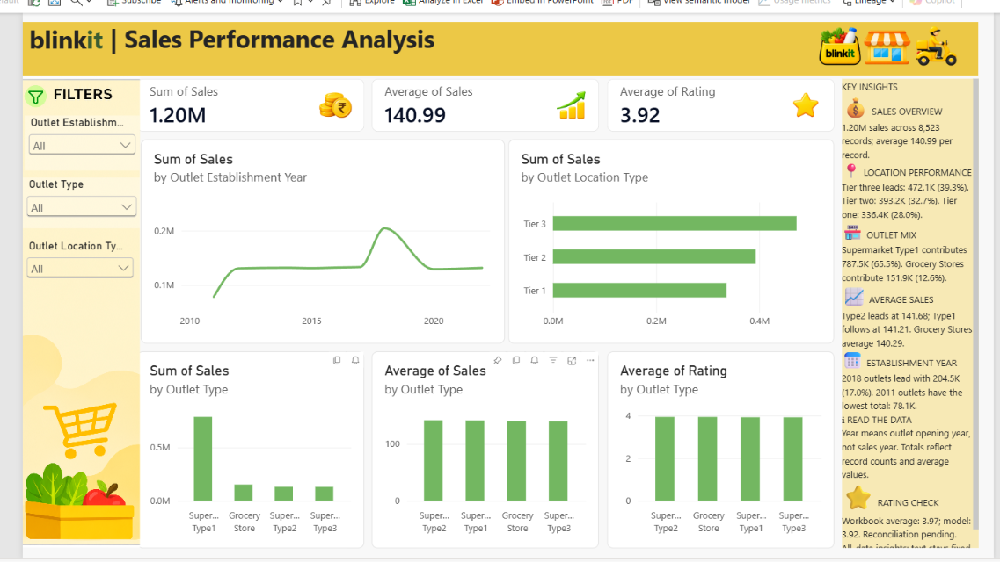

# BlinkIT Grocery Sales Dashboard

**Power BI Data Analytics Project | Sales, Product & Outlet Performance Analysis**

## 📊 Project Overview

This project presents an interactive **BlinkIT Grocery Sales Dashboard** developed using **Microsoft Power BI**.

The dashboard is designed to analyze grocery sales performance across products, outlets, outlet types, outlet sizes, and locations, helping users explore business performance through interactive visualizations and filters.

## 🎯 Project Objective

The objective of this project is to transform grocery sales data into an interactive business intelligence dashboard that can help users:

- Monitor key sales performance indicators
- Analyze product category performance
- Compare outlet performance
- Understand sales distribution across outlet types and locations
- Identify important business trends through interactive filtering

## 🛠️ Tools & Technologies

- **Microsoft Power BI** – Dashboard development and visualization
- **Power Query** – Data cleaning and transformation
- **DAX** – Calculations and analytical measures
- **Data Visualization** – Interactive charts, KPI cards and slicers
- **Business Intelligence** – Performance analysis and reporting

## 📈 Key KPIs

The dashboard includes analysis of:

- **Total Sales**
- **Average Sales**
- **Number of Items**
- **Average Rating**
- **Outlet Performance**
- **Product Category Performance**

## 🔍 Analysis Covered

### Sales Analysis

Analysis of overall sales performance and sales distribution across different business dimensions.

### Product Analysis

Comparison of sales performance across different grocery product categories.

### Outlet Analysis

Analysis of outlet performance based on:

- Outlet Type
- Outlet Size
- Outlet Location
- Establishment Information

### Business Performance

Interactive filtering and visualization are used to explore sales trends and compare business performance across different dimensions.

## 📌 Dashboard Features

- Interactive KPI cards
- Sales performance analysis
- Product category analysis
- Outlet type analysis
- Outlet size analysis
- Location-based analysis
- Interactive slicers and filters
- Business performance visualizations
- Power BI data model
- DAX-based calculations

## 💡 Key Insights

The dashboard enables users to explore:

- Top-performing product categories
- High-performing outlet types
- Sales contribution by outlet location
- Sales patterns across outlet sizes
- Overall grocery sales performance

> **Note:** Specific numerical findings should be interpreted directly from the interactive Power BI dashboard.

## 📂 Project Files

| File | Description |
|---|---|
| `BlinkIT Grocery Sales Dashboard (1).pbix` | Power BI dashboard, data model and analysis |
| `README.md` | Project documentation |

## 🚀 How to Use

1. Download the `.pbix` Power BI file from this repository.
2. Open the file using **Microsoft Power BI Desktop**.
3. Use the available slicers and filters to explore the dashboard.
4. Interact with the visualizations to analyze sales and outlet performance.

## 🧠 Skills Demonstrated

- Data Analysis
- Data Cleaning
- Data Transformation
- DAX
- Power BI Dashboard Development
- Business Intelligence
- Data Visualization
- KPI Development
- Business Performance Analysis

## 📸 Dashboard Preview

## 👨‍💻 Author

**Vikas Chaubey**

**Data Analyst | MIS & Business Intelligence**

---

⭐ If you find this project useful, feel free to star the repository.
